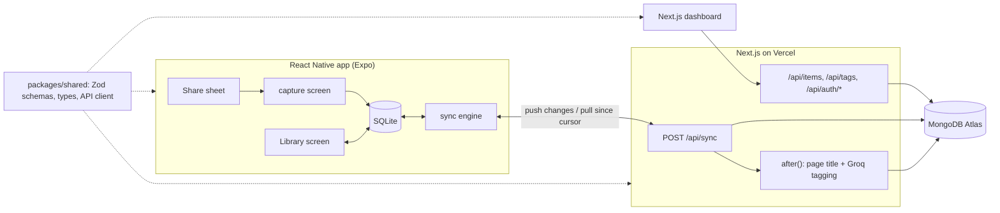

# Recall

Save anything from any app on your phone with one tap on **Share → Recall**. It works offline, syncs when you're back online, and gets auto-tagged and summarized by AI. Search everything later on your phone or on the web dashboard.

**Stack:** React Native (Expo SDK 57, Expo Router) · Next.js 16 (App Router, Route Handlers) · TypeScript · Turborepo · MongoDB (Mongoose) · SQLite (on device) · Groq LLM · Zod

## Why it's built this way

| Feature | What it shows |
| --- | --- |
| Share-sheet capture (Android intent filter + iOS share extension) | Native platform integration, not just screens |
| Offline-first: the UI only reads local SQLite | Mobile data architecture |
| Two-way sync with last-write-wins and tombstones | Distributed-data reasoning |
| One shared package for types, validation and the API client | Code sharing across React, React Native and Next.js |
| AI enrichment runs after the response (`after()`) | Not blocking users on slow work |
| JWT in SecureStore on mobile, httpOnly cookie on web | Platform-appropriate auth |

## Architecture



```
recall/
├── apps/
│   ├── mobile/          Expo app
│   │   ├── app/         screens (Expo Router): index, login, capture, +native-intent
│   │   └── lib/         db.ts (SQLite), sync-engine.ts, sync.tsx, auth.tsx, theme.ts
│   └── web/             Next.js app
│       ├── app/api/     auth, items, tags, sync route handlers
│       ├── components/  Dashboard
│       └── lib/         db, models, auth, ai, http
└── packages/shared/     schemas.ts, api.ts, text.ts (used by both apps)
```

## How sync works

1. **Saving is always local.** A new item gets a UUID on the phone and is written to SQLite with `dirty = 1`. The UI updates instantly, online or not.
2. **When sync runs** (sign-in, network reconnect, app foreground, after a save, pull-to-refresh), the phone sends all dirty items plus `since`, the cursor from its last sync.
3. **Push.** The server upserts by `(userId, clientId)`, so retrying the same batch is safe. On a conflict, the newer `updatedAt` wins.
4. **Pull.** The server returns everything whose `syncedAt` is after `since`. `syncedAt` uses the **server's** clock, because phone clocks drift. The returned cursor is moved back 5 seconds so a write that lands during the query isn't missed. Duplicates are harmless because the client upserts by id.
5. **Deletes are tombstones** (`deletedAt`), so a delete on the web reaches the phone and vice versa.
6. **AI tags arrive later.** Tagging runs after the response, then bumps `syncedAt`, so the phone picks up the tags on its next pull.

## Run it locally

You need Node 20+, a free MongoDB Atlas cluster, a Groq API key (optional), and Android Studio or a physical Android phone.

```bash
npm install

# Web + API
cp apps/web/.env.example apps/web/.env.local     # fill in MONGODB_URI and JWT_SECRET
npm run dev:web                                   # http://localhost:3000

# Mobile (separate terminal)
cp apps/mobile/.env.example apps/mobile/.env      # set your computer's LAN IP
cd apps/mobile
npx expo run:android                              # first run builds the native app
```

The share sheet uses native code, so the app **does not run in Expo Go**. `expo run:android` builds a development client. After that, `npm run start` is enough for day-to-day JS changes.

To test sharing: open Chrome on the phone, tap **Share → Recall** on any page.

## Deploy

**Web/API to Vercel:** import the repo, set the root directory to `apps/web`, and add the env vars from `.env.example`. In Atlas, allow network access from anywhere (`0.0.0.0/0`), because Vercel IPs aren't fixed.

**Mobile with EAS:**

```bash
npm install -g eas-cli
cd apps/mobile
eas login && eas init          # links the project, adds projectId to app.json
# put your Vercel URL into the env blocks in eas.json
eas build -p android --profile preview      # installable APK to share with testers
eas build -p android --profile production   # .aab for the Play Store
```

**Play Store:** create a developer account (one-time fee), create the app, and upload the `.aab` to **Closed testing**. New personal developer accounts must run a closed test with at least 12 testers for 14 days before applying for production access, so start this early.

## Roadmap

- [ ] Images: share screenshots, upload to object storage, run OCR so they're searchable
- [ ] Daily "resurface" push notification with something saved a while ago
- [ ] Edit tags on mobile (the sync model already supports updates)
- [ ] Sentry crash reporting and EAS Update for over-the-air fixes
- [ ] Rate limiting on auth routes; DNS-level SSRF protection for link fetching
- [ ] Atlas Search instead of regex search once the data grows
- [ ] Tests: sync conflict cases (Vitest) and a Maestro end-to-end flow for share → sync
